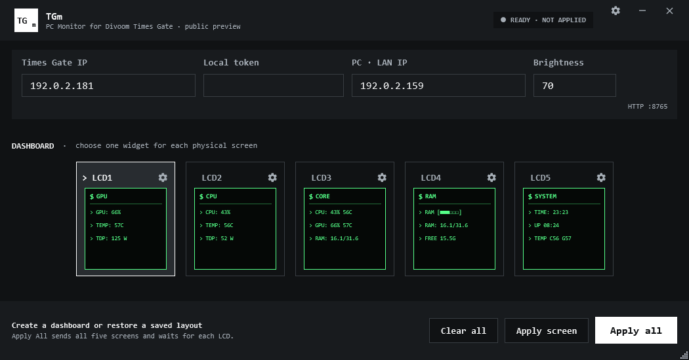

# TGm — PC Monitor for Divoom Times Gate

> Unofficial monitor for Divoom Times Gate.  
> This project is not affiliated with or endorsed by Divoom.

TGm is an open-source Windows desktop application that shows live CPU, GPU and RAM data on the five displays of a Divoom Times Gate. Values are delivered as network text, so normal sensor updates do not upload a new image to the device.



[Русская версия](docs/README.ru.md)

## Status

TGm is preparing for its first public preview. Treat pre-release builds as test software and keep the original Divoom app available for recovery.

> [!WARNING]
> **Known device-restart issue:** during some long Network Text sessions, Times Gate has returned to its stock clock face after roughly **35,000 requests recorded by TGm's local server**. Some runs complete for many hours without a failure. The exact threshold and root cause are not proven, and a successful HTTP response does not prove that a display rendered it. TGm detects prolonged LCD silence and attempts to restore the dashboard, but it cannot prevent the device-side event. See [Known issues](docs/KNOWN-ISSUES.md#times-gate-may-restart-or-return-to-a-stock-clock-face-during-long-sessions) before installing the preview.

## Features

- five independently configurable 125×125 display previews;
- GPU, CPU, combined core, RAM, system and clock presets;
- an empty custom widget and PNG/JPG/BMP/animated GIF imports;
- live preview while the application window is open;
- per-widget text and frame colors, header symbols and value rows;
- system tray, start with Windows, start minimized, pause and reconnect;
- passive per-LCD health tracking and selective recovery when one display resets;
- an always-available **REAPPLY ALL** action for manually restoring all five displays;
- optional elevated sensor host for CPU temperature, power and clock;
- LocalToken stored in Windows Credential Manager, not in configuration or logs.

FPS monitoring is intentionally out of scope for the first public release.

## Requirements

- Windows 10 or Windows 11, x64;
- a Divoom Times Gate connected to the same local network as the PC;
- the device IPv4 address and LocalToken from the Divoom mobile app;
- PawnIO when the selected CPU requires low-level access for temperature, power or clock readings.

The TGm interface always runs as the current user. CPU load has a non-elevated Windows fallback. Extended CPU sensors are optional and require one UAC approval to register `TGm.SensorHost`; the helper runs only while TGm requests readings and stops after an idle timeout.

## Run from source

Install the .NET 8 SDK, then run:

```powershell
dotnet restore TimesGateMonitor.sln
dotnet build TimesGateMonitor.sln -c Release --no-restore
dotnet run --project tests/TimesGateMonitor.Tests -c Release --no-build
dotnet run --project src/TimesGateMonitor.App -c Release --no-build
```

The test project is a small executable test harness, so it is started with `dotnet run` rather than `dotnet test`.

## Build a release archive

```powershell
.\scripts\Build-Release.ps1 -Version 0.1.0-preview.1
```

The script creates a self-contained Windows x64 folder, ZIP archive and `.sha256` checksum under `release/`. It merges the matching sensor host, license notices and safe removal script into the same package. Use `-FrameworkDependent` only when producing the smaller variant that requires the .NET 8 Desktop Runtime.

Tagged GitHub builds run the same tests, create the portable archive and compile an Inno Setup per-user installer. Public preview binaries are unsigned until the project obtains a code-signing certificate, so Windows SmartScreen may show an unknown-publisher warning. Verify the published SHA-256 checksum before running an unsigned preview.

## First connection

1. Open TGm normally, without administrator rights.
2. Enter the Times Gate IPv4 address, LocalToken and this PC's LAN IPv4 address.
3. Select a widget for one screen and use **APPLY SCREEN**.
4. When the result is correct, configure the remaining screens and use **APPLY CHANGES**.
5. Open the gear menu and enable **CPU SENSOR ACCESS** only if you need extended CPU sensors.

Times Gate fetches live values from TCP port `8765` on the PC. VPN or firewall software that filters local traffic may need an explicit LAN exception. TGm never sends telemetry to a cloud service.

## Data and security

- settings and logs: `%LOCALAPPDATA%\TGm`;
- dashboard layout and imported media: `%LOCALAPPDATA%\TimesGateMonitor`;
- LocalToken: Windows Credential Manager target `TGm/TimesGateMonitor/LocalToken`;
- sensor host: a local named pipe restricted to the Windows user who enabled it.

Do not attach your LocalToken to an issue or diagnostic report. See [SECURITY.md](SECURITY.md) for vulnerability reports.

## Repository layout

```text
src/
  TimesGateMonitor.App/        WPF application and dashboard editor
  TimesGateMonitor.Core/       models and interfaces
  TimesGateMonitor.Hardware/   hardware sensors and sensor-host client
  TimesGateMonitor.Rendering/  128×128 widget renderer
  TimesGateMonitor.SensorHost/ optional elevated CPU sensor helper
  TimesGateMonitor.TimesGate/  local Times Gate protocol client
  TimesGateMonitor.Diagnostic/ developer diagnostics CLI
tests/
  TimesGateMonitor.Tests/      executable unit-test harness
docs/                          architecture and development notes
```

## Contributing

Read [CONTRIBUTING.md](CONTRIBUTING.md) before opening a pull request. Generated builds, local package caches, logs, imported media and real credentials must not be committed.

The remaining manual release gates are tracked in [docs/PUBLIC-RELEASE-CHECKLIST.md](docs/PUBLIC-RELEASE-CHECKLIST.md).

If you are the repository owner preparing the first publication, follow the [GitHub publishing guide (Russian)](docs/GITHUB-PUBLISHING-GUIDE-RU.md). It intentionally keeps repository creation, the first push, tagging and release publication as manual owner actions.

## License and trademarks

TGm source code is licensed under the [MIT License](LICENSE). Distributed builds also contain third-party components under MPL-2.0, Apache-2.0 and MIT terms; see [THIRD-PARTY-NOTICES.md](THIRD-PARTY-NOTICES.md).

Divoom and Times Gate are used only to identify compatible hardware. All trademarks belong to their respective owners.
